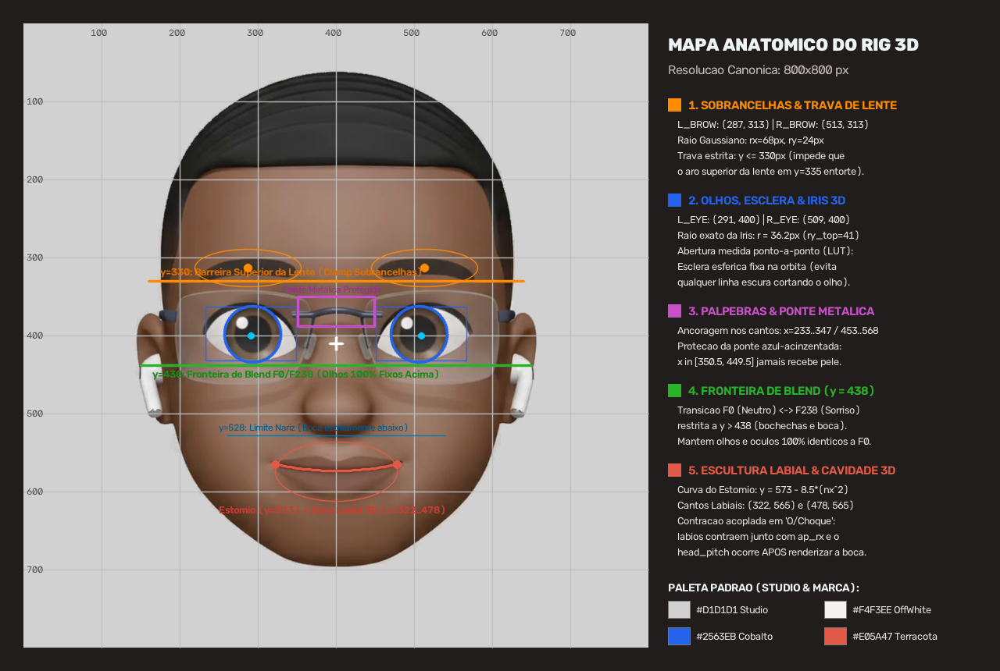
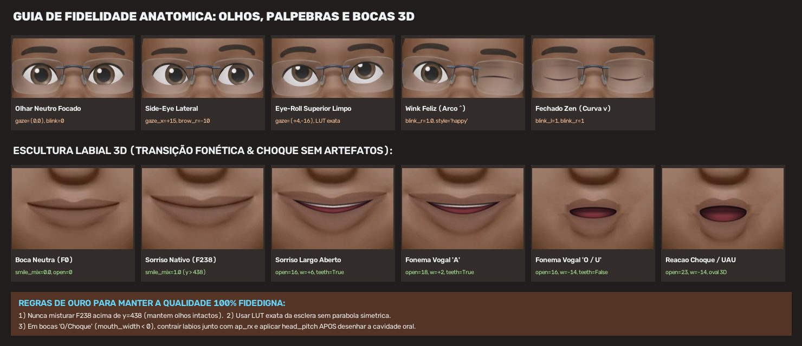

# Manual de Estilização 3D e Regras de Fidelidade — Emoji Primordial (Estoke ao Cubo)

## 1. Visão Geral e o "Padrão Ouro"

O **Emoji Primordial** é o personagem central e assinatura visual dos vídeos e motions da **Estoke ao Cubo**. Toda derivação estática ou animada deve preservar **100% de fidelidade** ao vídeo de referência mestre ([`PADRAO_OURO_REFERENCIA_3D.mp4`](../05_ENGINE_E_FONTES_MESTRES/PADRAO_OURO_REFERENCIA_3D.mp4)).

### Especificações Visuais Imutáveis
| Atributo | Especificação Padrão Ouro | Regra de Preservação |
| :--- | :--- | :--- |
| **Fundo Studio Padrão** | `#D1D1D1` (`RGB: 209, 209, 209` / `BGR: 209, 209, 209`) | Todas as animações `.mp4` e `.gif` e os PNGs da pasta `02_FEICOES_FUNDO_PADRAO_STUDIO` devem usar exatamente `#D1D1D1` sem vinheta ou gradiente. |
| **Resolução Canônica** | `800×800 px` (Feições Estáticas) / `720×720 px` @ `24 fps` (Animações) | Recorte central do vídeo mestre `x = 280..1000, y = 0..720` reamostrado com `cv2.INTER_LANCZOS4`. |
| **Iluminação 3D e Pele** | Subsurface Scattering (SSS) quente em estilo Memoji/Pixar | Jamais usar sombras pretas puras (`#000000`) na pele, pálpebras ou lábios. Sombras internas usam tons terrosos/borgonha quentes. |
| **Óculos Rimless (Sem Aro)** | Lentes retangulares translúcidas (`y = 335..463`) + ponte metálica azul-acinzentada (`x = 351..449`) | As lentes e a ponte metálica são **rígidas**. Nenhuma deformação de sobrancelha ou piscada pode entortar ou cobrir a ponte metálica. |
| **AirPods Pro & Cabelo Waves** | Fones brancos (`y = 460..640`) e ondas 360° no couro cabeludo | No recorte Alpha (`01_FEICOES_PNG_TRANSPARENTE`), proteger a faixa `y = 460..680` contra remoção de brancos para não amputar a haste dos AirPods. |

---

## 2. As 5 Leis de Fidelidade Anatômica (Anti-Artefatos)

### Lei 1 — Proibição de Mistura de `F238` na Parte Superior do Rosto (`y <= 438`)
* **O Problema**: O quadro `F0` (neutro) e o quadro `F238` (sorriso nativo 3D) possuem uma diferença vertical de ~2px na posição das pálpebras e óculos. Misturar `F0` e `F238` na região dos olhos cria uma **linha fantasma horizontal** cortando os olhos e borrando os cílios.
* **A Regra Técnica**: A máscara `self.w_lower_face = np.clip((self.yy - 438.0) / 10.0, 0.0, 1.0)` garante que a transição `F0 <-> F238` (`smile_mix` ou `smirk_dir`) ocorra **exclusivamente abaixo de `y = 438`** (bochechas, bigode chinês, lábios e queixo). Acima de `y = 438`, os olhos, óculos e sobrancelhas vêm 100% do quadro `F0`.

### Lei 2 — Abertura Ocular Medida Ponto-a-Ponto (LUT) e Esclera Fixa na Órbita
* **O Problema**: Aproximar o olho por uma parábola matemática simétrica deixa de fora 4 a 6 pixels da esclera real nos cantos internos/externos, criando uma **linha curva escura cortando o olho** quando a íris se move. Além disso, deslocar a textura original da esclera junto com a íris traz a sombra marrom da pálpebra inferior para o meio do olho em olhares para cima (*eye-roll* / *pensativo*).
* **A Regra Técnica**:
  1. Usar sempre as curvas medidas coluna-a-coluna em `_build_exact_lut_apertures()` (`pts_top_l`, `pts_top_r`, `pts_bot_l`, `pts_bot_r`).
  2. Manter a esclera esférica 3D **fixa na órbita** (`sclera_bgr = [220, 219, 223] * sph_shade`) e mover apenas a íris circular limpa (`r = 36.2 px`, com extensão superior `ry_top = 41.0 px`) dentro da máscara LUT.
  3. Reaplicar a faixa fina de cílios superiores (`self.lash_both`) por cima da íris movida.

### Lei 3 — Pálpebras 3D Ancoradas nos Cantos com Proteção da Ponte Metálica
* **O Problema**: Piscadas feitas por *warp* elástico puxam a lente dos óculos para baixo; piscadas feitas por pintura simples sem máscara invadem a ponte metálica azul-acinzentada no centro do nariz.
* **A Regra Técnica**:
  1. Em `_apply_3d_blink()`, a pele da pálpebra (`lid_skin`) é interpolada verticalmente a partir da pele real interna à lente (`y = 351..437`) com curvatura cilíndrica 3D (`bulge`) e vinco palpebral (`crease_sub`).
  2. A linha dos cílios (`lash_y`) interpola continuamente da borda superior aberta (`y_open_l` / `y_open_r`) até a curva fechada ancorada nos cantos (`closed_bot_y`), suportando dois estilos:
     - `arch_style="relaxed"`: curva suave para baixo (`414.5 - 12.0 * nx_c^2`), ideal para piscadas naturais e expressão Zen.
     - `arch_style="happy"`: arco alegre para cima (`397.0 + 6.5 * nx_c^2`), ideal para piscadinhas (*wink*) e sorrisos.
  3. A máscara `bridge_safe` bloqueia qualquer pintura em `x >= 350.5` (olho esquerdo) e `x <= 449.5` (olho direito) e em pixels com assinatura cromática azul-metálica (`(B - R) > 8`), mantendo a ponte dos óculos intacta.

### Lei 4 — Barreira Rígida das Sobrancelhas Acima das Lentes (`y <= 330`)
* **O Problema**: Quando a sobrancelha desce (expressão brava/séria, `brow_dy > 0`), o campo de deformação Gaussiano pode atingir a borda superior da lente sem aro em `y = 335`, entortando o vidro.
* **A Regra Técnica**: Multiplicar o peso da sobrancelha por `above_lens = np.clip((330.0 - self.yy) / 5.0, 0.0, 1.0)` e limitar `dy <= 330.0 - self.yy` na zona `y = 250..331.5`. Assim, as sobrancelhas têm liberdade total de expressão sem jamais tocar em `y >= 331`.

### Lei 5 — Escultura Labial 3D Acoplada e Paralaxe Pós-Cavidade
* **O Problema**:
  1. Ao abrir a boca em formato arredondado ("O", "U", "UAU / Choque" com `mouth_width < 0`), se apenas a cavidade central estreitar (`ap_rx`) sem contrair todo o lábio, sobram "asas" horizontais da boca fechada nas laterais e o topo da boca fica reto.
  2. Se o movimento vertical da cabeça (`head_pitch`) for aplicado antes da renderização da cavidade oral, os lábios e o interior da boca se descolam verticalmente, deixando uma linha preta acima da boca.
* **A Regra Técnica**:
  1. **Pré-limpeza do Estômio e Comissuras**: Quando `mouth_open > 0.8`, suavizar a linha escura central da boca fechada (`stom_band`) e, quando `mouth_width < -1.0`, suavizar as pontas externas (`|x - 400| in [62..98]`) com pele da bochecha (`wing_mask`).
  2. **Contração Horizontal Acoplada (`scale_x`)**: Contrair horizontalmente todo o corpo labial (`r_lip_0 = 66 px -> r_lip_target = ap_rx + 7.5 px`) para que o arco do cupido e o lábio inferior envolvam perfeitamente a abertura oval.
  3. **Decomposição Suave de `dy_split`**: Separar o deslocamento da linha média (`dy_mid`, contínuo em `y`) da abertura labial (`up_shift` / `dn_shift`), eliminando qualquer degrau de 1px nos cantos da boca.
  4. **Ordem de Execução Obrigatória**: Renderizar a cavidade oral 3D (rolo labial interno quente `BGR [72, 74, 118]`, cavidade borgonha escura `BGR [34, 28, 62]`, língua 3D arredondada `BGR [66, 60, 138]` e dentes superiores opcionais) **ANTES** de aplicar o `cv2.remap` de `head_yaw` e `head_pitch` (Passo 8).

---

## 3. Paleta Cromática Oficial da Anatomia 3D

Para manter a consistência de iluminação e textura em qualquer manutenção futura do código:

| Elemento Anatômico | Valor BGR (OpenCV) | Valor RGB / Hex | Função Visual |
| :--- | :--- | :--- | :--- |
| **Fundo Studio Padrão** | `(209, 209, 209)` | `#D1D1D1` | Fundo neutro de estúdio 3D idêntico ao vídeo original |
| **Esclera 3D (Luz Central)** | `(220, 219, 223)` | `#DFDBDCD` | Branco quente esférico com sombreamento orbital `0.88..1.0` |
| **Cílios / Linha Palpebral** | `(32, 25, 36)` | `#241920` | Marrom-café profundo anti-serrilhado (nunca preto puro) |
| **Rolo Interno do Lábio (Mucosa)**| `(72, 74, 118)` | `#764A48` | Transição suave sub-superfície entre pele labial e cavidade |
| **Cavidade Oral Profunda** | `(34, 28, 62)` | `#3E1C22` | Sombra interna borgonha-escura do palato |
| **Língua 3D (Domo Iluminado)** | `(66, 60, 138)` | `#8A3C42` | Terracota/rosa quente com sombreamento cilíndrico |
| **Dentes Superiores** | `(208, 216, 228)` | `#E4D8D0` | Marfim natural com micro-sulcos e oclusão de ambiente superior |
