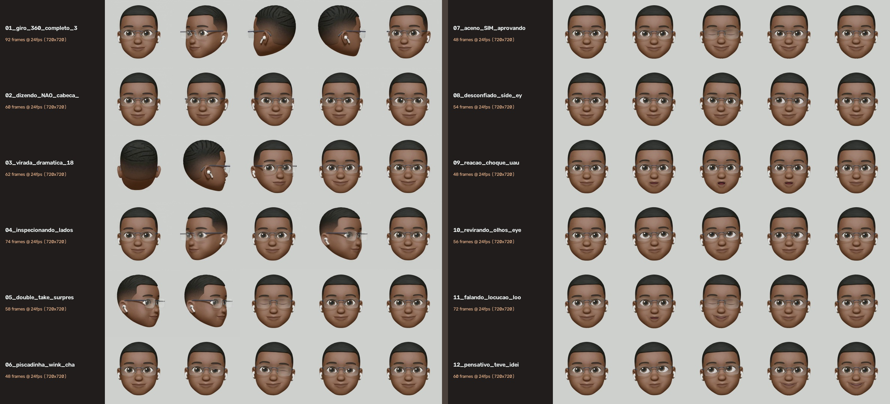

# Guia Técnico da Engine `PrimordialFaceSculptor` e Catálogo de Parâmetros

Este documento detalha o funcionamento da engine [`build_primordial_library.py`](../05_ENGINE_E_FONTES_MESTRES/build_primordial_library.py), a tabela completa de parâmetros do método `sculpt()` e as receitas exatas das **36 Feições Estáticas** e **12 Animações Reais 3D**.

---

## 1. Pipeline de Execução do Método `sculpt()` (Ordem Estrita de 9 Passos)

Toda chamada a `sculptor.sculpt(**params)` executa exatamente os seguintes 9 passos em ordem:

1. **Seleção / Blend da Base (`F0` Neutro vs. `F238` Sorriso Nativo 3D)**:
   - Calcula `eff_smile_mix` (`0.0..1.0`) ou mistura assimétrica (`smirk_dir` `-1.0..+1.0`).
   - Multiplica a máscara de mistura por `self.w_lower_face` (`y > 438`), preservando os olhos e óculos de `F0` intactos.
2. **Rastreamento Rígido de Olhar (`_move_gaze_rigid(gaze_x, gaze_y)`)**:
   - Move a íris circular (`r = 36.2 px`) sobre a esclera esférica fixa na órbita, recortada pela máscara LUT exata (`self.inner_both`), e restaura os cílios superiores (`self.lash_both`).
3. **Pálpebras 3D Ancoradas nos Cantos (`_apply_3d_blink(blink_l, blink_r, arch_style)`)**:
   - Renderiza o fechamento parcial ou total das pálpebras dentro das lentes respeitando a proteção da ponte metálica (`bridge_safe`).
4. **Escala Radial dos Olhos (`eye_scale`)**:
   - Acumula no campo `(dx, dy)` uma expansão/contração suave centrada em `(291, 400)` e `(509, 400)` (`r = 36 px`) para expressões de choque/surpresa.
5. **Escultura das Sobrancelhas (`brow_l_dy`, `brow_r_dy`, `brow_tilt_l`, `brow_tilt_r`)**:
   - Desloca e inclina as sobrancelhas em `(287, 313)` e `(513, 313)` com trava rígida em `y <= 330` (`above_lens`).
6. **Escultura Labial 3D e Abertura do Estômio (`smile_l`, `smile_r`, `mouth_open`, `mouth_width`)**:
   - Pré-limpa o vinco da boca fechada (`stom_band`) quando `mouth_open > 0.8` e suaviza as comissuras externas (`wing_mask`) quando `mouth_width < -1.0`.
   - Aplica contração/expansão horizontal acoplada (`scale_x`) e abertura vertical suave (`dy_split`) e executa o primeiro `cv2.remap(..., cv2.INTER_LANCZOS4)`.
7. **Renderização da Cavidade Oral 3D, Mucosa, Língua e Dentes (`show_teeth`)**:
   - Desenha o rolo labial interno quente, a cavidade borgonha escura, a língua 3D arredondada e a arcada dentária superior opcional diretamente sobre os lábios abertos.
8. **Paralaxe 2.5D de Cabeça Pós-Cavidade (`head_yaw`, `head_pitch`)**:
   - Executa um segundo `cv2.remap` deslocando o rosto já com a cavidade oral renderizada, garantindo zero descolamento entre boca e lábios.
9. **Rotação Planar da Cabeça (`head_roll`)**:
   - Aplica `cv2.warpAffine` em torno do pivô central `(400.0, 410.0)` com `cv2.INTER_LANCZOS4`.

---

## 2. Dicionário de Parâmetros do `sculpt()` e Faixas Seguras

| Parâmetro | Tipo | Padrão | Faixa Segura Recomendada | Efeito Anatômico |
| :--- | :--- | :--- | :--- | :--- |
| `use_smile_base` | `bool` | `False` | `False` ou `True` | Ativa a base de sorriso nativo 3D (`F238`) abaixo de `y = 438`. |
| `smile_mix` | `float \| None` | `None` | `0.0` a `1.0` | Cross-fade contínuo entre base neutra (`0.0`) e base sorridente (`1.0`). Ideal para animações de fala e transição de humor. |
| `smirk_dir` | `float` | `0.0` | `-1.0` (esq) a `+1.0` (dir) | Mistura assimétrica de sorriso de canto (*smirk*). |
| `gaze_x` | `float` | `0.0` | `-15.0` (esq) a `+15.0` (dir) | Deslocamento horizontal da íris em pixels. |
| `gaze_y` | `float` | `0.0` | `-16.0` (cima) a `+8.0` (baixo) | Deslocamento vertical da íris em pixels (`-16` = *eye-roll* / topo). |
| `blink_l`, `blink_r`| `float` | `0.0` | `0.0` (aberto) a `1.0` (fechado)| Fechamento independente da pálpebra esquerda e direita. |
| `blink_style` | `str` | `"relaxed"`| `"relaxed"` ou `"happy"` | Curva da pálpebra fechada: `"relaxed"` (curva Zen para baixo) ou `"happy"` (arco alegre para cima). |
| `eye_scale` | `float` | `0.0` | `-0.06` a `+0.14` | Dilatação/contração radial dos olhos (`+0.12` = olhos arregalados de choque). |
| `brow_l_dy`, `brow_r_dy` | `float` | `0.0` | `-13.0` (sobe) a `+10.0` (desce)| Elevação (`< 0`) ou franzimento (`> 0`) vertical das sobrancelhas. |
| `brow_tilt_l`, `brow_tilt_r` | `float` | `0.0` | `-10.0` (triste) a `+10.0` (bravo)| Inclinação angular das sobrancelhas (`> 0` abaixa o canto interno; `< 0` levanta o canto interno). |
| `smile_l`, `smile_r`| `float` | `0.0` | `-10.0` (triste) a `+10.0` (feliz)| Puxada vertical/diagonal dos cantos da boca. |
| `mouth_open` | `float` | `0.0` | `-5.0` (M/B/P) a `+24.0` (Choque)| Abertura vertical da boca em pixels (`< 0` comprime os lábios; `> 0` abre a cavidade oral). |
| `mouth_width` | `float` | `0.0` | `-14.0` (O/U/UAU) a `+8.0` (E/I) | Largura horizontal da boca (`< 0` contrai em oval arredondado; `> 0` alarga o sorriso). |
| `show_teeth` | `bool` | `True` | `True` (A/E/Sorriso) / `False` (O/U/Choque) | Exibe ou oculta a fileira superior de dentes dentro da cavidade oral. |
| `head_yaw` | `float` | `0.0` | `-8.0` a `+8.0` | Giro horizontal sutil 2.5D da face. |
| `head_pitch` | `float` | `0.0` | `-8.0` (cima) a `+10.0` (baixo) | Inclinação vertical 2.5D da cabeça (aceno "SIM" ou recuo de choque). |
| `head_roll` | `float` | `0.0` | `-10.0°` a `+10.0°` | Inclinação lateral da cabeça em graus. |

---

## 3. Catálogo Completo das 36 Feições Estáticas (`800×800 px`)


### Grupos A & B — 20 Feições Esculpidas pelo Rig (`01` a `20`)
| Arquivo (`.png`) | Receita Exata de Parâmetros (`sculpt`) | Uso Recomendado em Motions |
| :--- | :--- | :--- |
| `01_neutro_focado` | `use_smile_base=False` | Pose base, escuta ativa, início/fim de loops |
| `02_sorriso_gentil` | `use_smile_base=True` | Empatia, boas-vindas, aprovação leve |
| `03_sorriso_largo_feliz` | `use_smile_base=True, smile_l=7, smile_r=7, mouth_open=16, mouth_width=6, brow_l_dy=-7, brow_r_dy=-7, show_teeth=True` | Comemoração, resultado positivo, CTA final |
| `04_sorriso_maroto_smirk_dir`| `smirk_dir=1.0, smile_r=9, brow_l_dy=4, brow_r_dy=-11, gaze_x=5` | Ironia inteligente, "segredo de mercado", confiança |
| `05_sorriso_maroto_smirk_esq`| `smirk_dir=-1.0, smile_l=9, brow_l_dy=-11, brow_r_dy=4, gaze_x=-5` | Contra-argumento confiante olhando para a esquerda |
| `06_piscadinha_wink_direito` | `use_smile_base=True, blink_r=1.0, blink_style="happy", smile_r=8, brow_l_dy=-8, brow_r_dy=3, head_roll=-3` | Charme, dica prática, cumplicidade com o cliente |
| `07_piscadinha_wink_esquerdo`| `use_smile_base=True, blink_l=1.0, blink_style="happy", smile_l=8, brow_r_dy=-8, brow_l_dy=3, head_roll=3` | Variação simétrica de *wink* para composições à direita |
| `08_olhos_fechados_zen` | `use_smile_base=True, blink_l=1.0, blink_r=1.0, blink_style="relaxed", smile_l=3, smile_r=3` | Alívio, paz de espírito, automação funcionando |
| `09_sobrancelha_arqueada_rock`| `smirk_dir=0.8, brow_l_dy=6, brow_r_dy=-13, brow_tilt_r=-5, smile_r=6` | Questionamento provocativo ("Tem certeza disso?") |
| `10_desconfiado_side_eye_dir`| `gaze_x=15, brow_l_dy=5, brow_r_dy=-10, smile_l=-5` | Olhar lateral avaliando erro do concorrente (direita) |
| `11_desconfiado_side_eye_esq`| `gaze_x=-15, brow_r_dy=5, brow_l_dy=-10, smile_r=-5` | Olhar lateral avaliando card/texto à esquerda |
| `12_surpreso_uau_chocado` | `eye_scale=0.12, brow_l_dy=-12, brow_r_dy=-12, mouth_open=23, mouth_width=-14, show_teeth=False` | Impacto, revelação de métrica alta, choque ("UAU!") |
| `13_bravo_serio_focado` | `brow_l_dy=9, brow_r_dy=9, brow_tilt_l=9, brow_tilt_r=9, smile_l=-7, smile_r=-7` | Alerta de prejuízo, dor do cliente, seriedade |
| `14_triste_desapontado` | `brow_l_dy=-4, brow_r_dy=-4, brow_tilt_l=-9, brow_tilt_r=-9, smile_l=-10, smile_r=-10, gaze_y=6` | Empatia com frustração, site lento, perda de vendas |
| `15_revirando_olhos_tedio` | `gaze_x=4, gaze_y=-16, brow_l_dy=-7, brow_r_dy=-7, smile_l=-6, smile_r=2, mouth_width=-5, head_roll=2.5` | Clichês de mercado, promessas falsas, impaciência |
| `16_pensativo_olhando_cima` | `gaze_x=-12, gaze_y=-11, brow_l_dy=-10, brow_r_dy=4, mouth_width=-7, smile_l=-3, head_roll=3` | Análise estratégica, calculando solução |
| `17_fala_vogal_A_aberto` | `use_smile_base=True, mouth_open=18, mouth_width=2, smile_l=3, smile_r=3, brow_l_dy=-5, brow_r_dy=-5, show_teeth=True` | Visema aberto (**A / Á**) para lip-sync |
| `18_fala_vogal_O_U_redondo` | `mouth_open=16, mouth_width=-14, brow_l_dy=-4, brow_r_dy=-4, show_teeth=False` | Visema arredondado (**O / Ô / U**) para lip-sync |
| `19_fala_vogal_E_I_sorrindo` | `use_smile_base=True, mouth_open=11, mouth_width=8, smile_l=5, smile_r=5, show_teeth=True` | Visema largo (**E / É / I**) para lip-sync |
| `20_fala_consoante_M_B_P` | `mouth_open=-5, mouth_width=4, brow_l_dy=-3, brow_r_dy=-3` | Visema bilabial fechado (**M / B / P**) para lip-sync |

### Grupo C — 12 Ângulos Reais 3D Extraídos do Turntable Mestre (`21` a `32`)
Extraídos diretamente dos quadros do vídeo de referência com recorte Alpha limpo:
* `21_angulo_3d_15_esq_focado` (Quadro `24`)
* `22_angulo_3d_30_esq_suave` (Quadro `32`)
* `23_angulo_3d_45_esq_tres_quartos` (Quadro `40`)
* `24_angulo_3d_65_esq_lateral` (Quadro `47`)
* `25_angulo_3d_90_esq_perfil` (Quadro `55`)
* `26_angulo_3d_135_esq_nuca` (Quadro `64`)
* `27_angulo_3d_180_costas_waves` (Quadro `72`)
* `28_angulo_3d_135_dir_nuca` (Quadro `80`)
* `29_angulo_3d_90_dir_perfil` (Quadro `89`)
* `30_angulo_3d_65_dir_lateral` (Quadro `94`)
* `31_angulo_3d_45_dir_tres_quartos` (Quadro `98`)
* `32_angulo_3d_25_dir_sorriso` (Quadro `198`)

### Grupo D — 4 Poses Expressivas Especiais Escalonadas (`33` a `36`)
* `33_inclinado_desconfiado_original`: Pose inclinada original com sobrancelha arqueada.
* `34_inclinado_curioso_esquerda`: Pose inclinada esculpida (`head_roll=9, brow_l_dy=-11, gaze_x=-8`).
* `35_estrategista_maos_piramide`: Pose "Estrategista" com mãos em pirâmide (furo central entre os dedos removido no Alpha).
* `36_impactado_segurando_coracao`: Pose dramática segurando coração 3D.

---

## 4. Catálogo e Storyboard das 12 Animações Reais 3D (`720×720 @ 24 fps`)



| # | Arquivo (`.mp4` / `.gif`) | Quadros / Duração | Mecânica de Animação 3D / 2.5D |
| :--- | :--- | :--- | :--- |
| **01** | `01_giro_360_completo_3d` | 92f (`3.83s`) | Turntable 3D completo (quadros `18..109` do vídeo mestre) mostrando frente, perfil, waves 360° na nuca e retorno. |
| **02** | `02_dizendo_NAO_cabeca_3d` | 60f (`2.50s`) | Oscilação amortecida (`sin(4*pi*t) * exp(-1.2*t)`) usando rotação 3D real da cabeça (`f_idx = 18..38`) com interpolação sub-frame. |
| **03** | `03_virada_dramatica_180_sorriso` | 62f (`2.58s`) | Começa de costas (`180°`, quadro `72`), gira rapidamente em 3D para a câmera e abre o sorriso nativo 3D (`214..238`). |
| **04** | `04_inspecionando_lados_3d` | 74f (`3.08s`) | Olha em 3D real para a esquerda (`18->42`), volta ao centro, olha para a direita e abre sorriso (`194->238`). |
| **05** | `05_double_take_surpresa_3d` | 58f (`2.42s`) | Olha de lado (`f=158`), vira rápido para a câmera, dá **duas piscadas rápidas** (`blink=1.0`) e arqueia a sobrancelha em choque. |
| **06** | `06_piscadinha_wink_charme` | 48f (`2.00s`) | Curva senoidal suave aplicando `blink_r=1.0 (style="happy")`, `smirk_dir=1.0`, `smile_r=9.0`, `brow_l_dy=-9.0` e `head_roll=-3.5°`. |
| **07** | `07_aceno_SIM_aprovando` | 48f (`2.00s`) | Duplo aceno afirmativo vertical (`head_pitch` amortecido), transição contínua `smile_mix=0->1` e piscada de confirmação. |
| **08** | `08_desconfiado_side_eye_rock` | 54f (`2.25s`) | Olhar lateral (`gaze_x = +/-15 px`), sobrancelha direita levantada (`-12 px`), esquerda franzida (`+5 px`) e leve giro `head_yaw`. |
| **09** | `09_reacao_choque_uau` | 48f (`2.00s`) | Olhos dilatados (`eye_scale=0.12`), sobrancelhas no alto (`-12 px`), boca em oval 3D perfeita (`mouth_open=23, mouth_width=-14`) e recuo `head_pitch=-5`. |
| **10** | `10_revirando_olhos_eye_roll` | 56f (`2.33s`) | Arco superior contínuo de 180° (`gaze_x: +14.5 -> 0 -> -14.5`, `gaze_y: 0 -> -16 -> 0`) com esclera 100% limpa, suspiro e piscada final. |
| **11** | `11_falando_locucao_loop` | 72f (`3.00s`) | Cadência fonética de 7 sílabas (*"Es-to-ke ao Cu-b-bo!"*) alternando vogais abertas (`A/E`), vogais redondas (`O/U`), fechamento bilabial (`B`) e `smile_mix` suave. |
| **12** | `12_pensativo_teve_ideia` | 60f (`2.50s`) | Fase 1: Pensativo olhando cima-esquerda (`gaze=(-13, -11.5)`). Fase 2: Piscada natural de transição enquanto o olhar volta. Fase 3: Sorriso iluminado de "Eureka!". |

---

## 5. Como Gerar ou Atualizar a Biblioteca

Sempre que desejar ajustar algum parâmetro ou adicionar uma nova feição/animação:

```powershell
cd "c:\Users\xavie\Downloads\NOVA LEVA DE MOTION"
python build_primordial_library.py
```

O script regenera automaticamente todas as 36 feições (nas pastas `01_FEICOES_PNG_TRANSPARENTE` e `02_FEICOES_FUNDO_PADRAO_STUDIO`), atualiza o `CATALOGO_36_FEICOES.jpg` e re-renderiza os 12 vídeos `.mp4` (H.264 `crf=17`) e `.gif` na pasta `03_ANIMACOES_REAIS_3D`.
