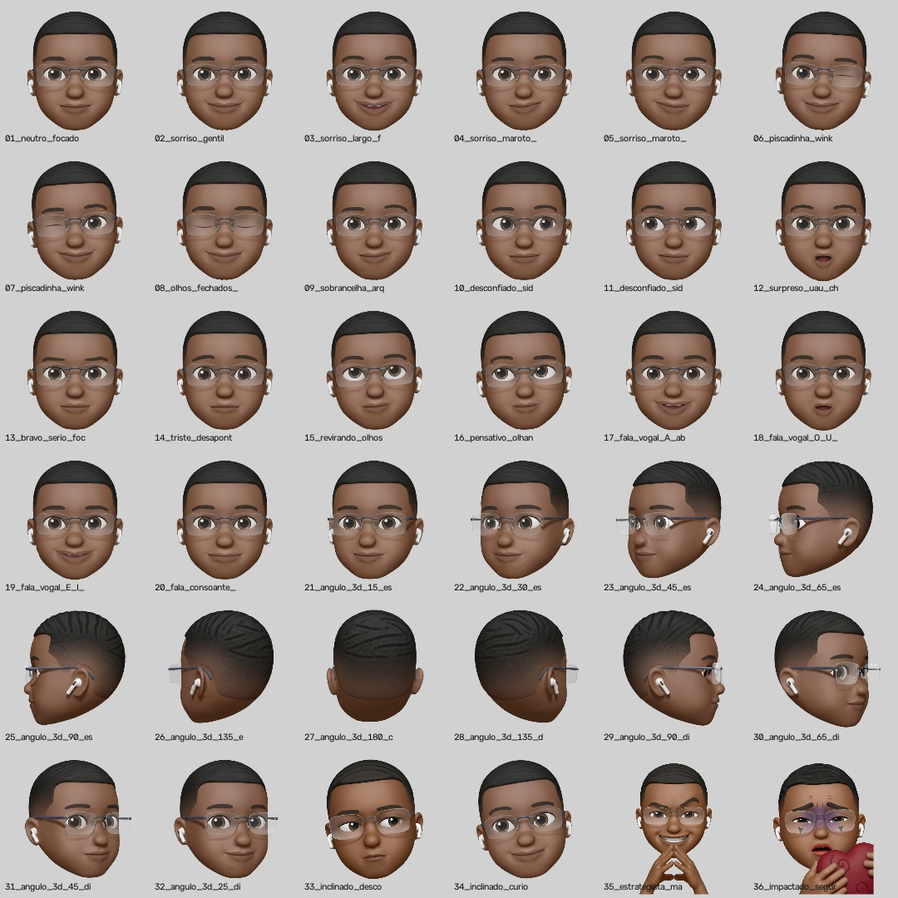
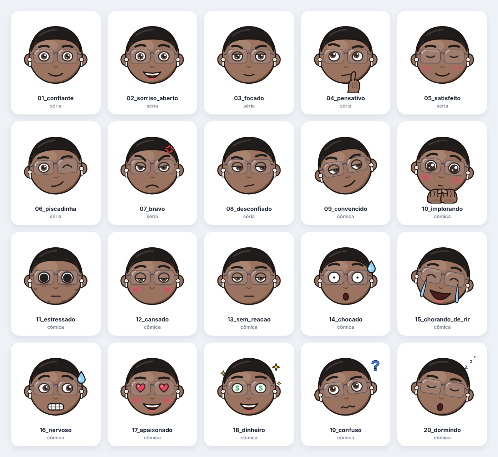
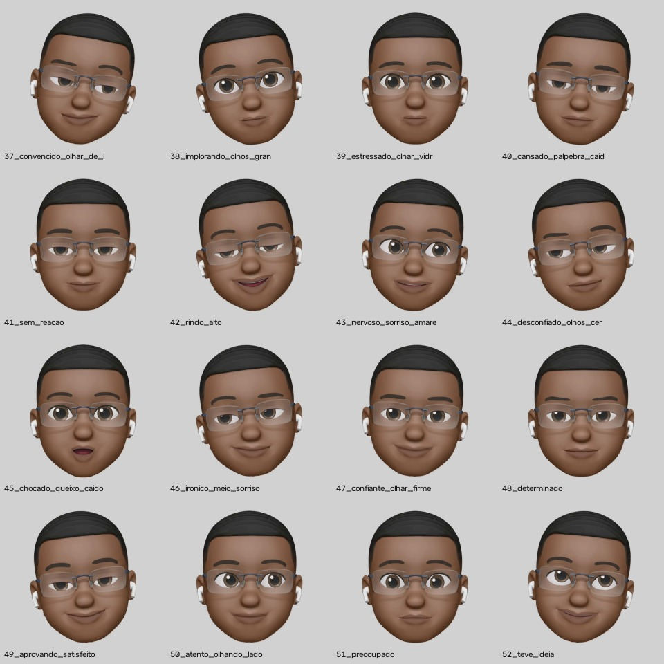
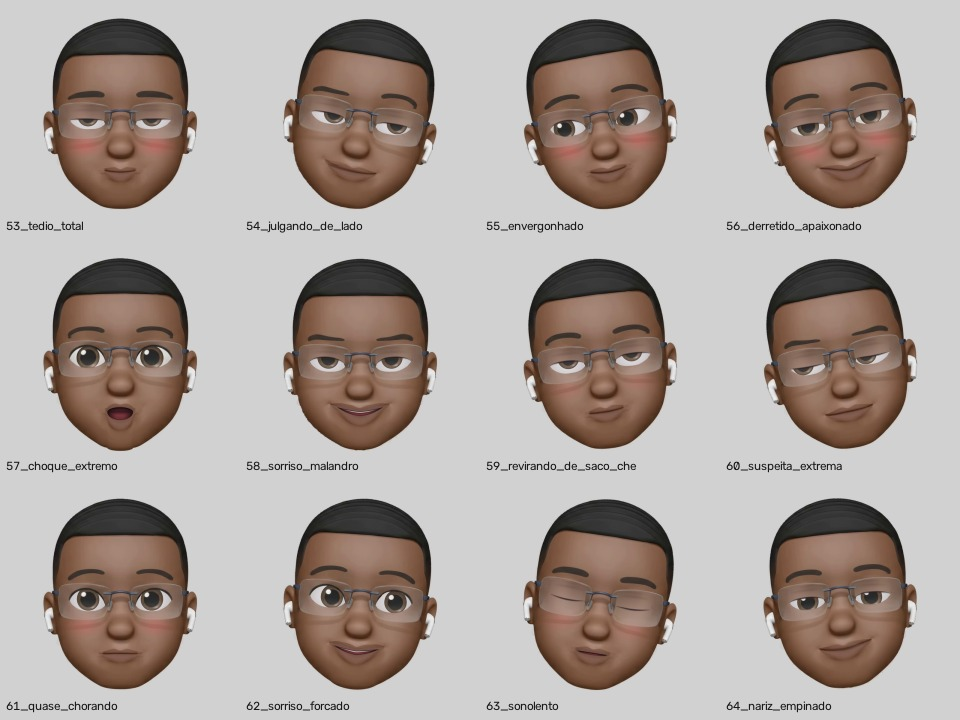

# Biblioteca Mestre — Emoji Primordial 3D (Estoke ao Cubo)

Esta pasta centraliza **todos os ativos oficiais, feições estáticas, animações 3D reais, códigos-fonte da engine e documentação técnica** do **Emoji Primordial** da **Estoke ao Cubo**.



> **Estado no repositório:** os arquivos subiram todos para a raiz do GitHub e foram organizados nesta estrutura.
> As pastas `01_FEICOES_PNG_TRANSPARENTE` e `02_FEICOES_FUNDO_PADRAO_STUDIO` usam os mesmos nomes de arquivo,
> então no upload uma versão sobrescreveu a outra. Chegaram 30 feições com fundo de estúdio e 6 transparentes:
> - **`02_FEICOES_FUNDO_PADRAO_STUDIO`:** completa (36). As 6 que faltavam (02, 26, 33, 34, 35, 36) foram geradas a partir das
>   versões transparentes, com a mesma composição sobre `#D1D1D1` da engine (`save_both_formats`).
> - **`01_FEICOES_PNG_TRANSPARENTE`:** só 6 de 36 (02, 26, 33, 34, 35 e 36). **Falta reenviar as outras 30** (01, 03–25, 27–32).

## Feições vetoriais 2D (`06_FEICOES_VETORIAIS_2D/`)

São 20 feições novas, 100% em SVG, do mesmo personagem num traço ilustrado de emoji de meme: contorno grosso, cor chapada, sombra simples, blush hachurado e gotas de suor. Continua sendo ele: pele marrom com as cores amostradas do 3D, cabelo curto com degradê, óculos sem aro com ponte azul-marinho, AirPods e olhos castanhos.



- **Sérias (refinadas):** 01 confiante, 02 sorriso aberto, 03 focado, 04 pensativo (mão no queixo), 05 satisfeito, 06 piscadinha, 07 bravo e 08 desconfiado.
- **Cômicas:** 09 convencido, 10 implorando (mãos juntas), 11 estressado, 12 cansado, 13 sem reação, 14 chocado, 15 chorando de rir, 16 nervoso, 17 apaixonado, 18 dinheiro, 19 confuso e 20 dormindo.
- **Como gerar:** `python3 EMOJI_PRIMORDIAL/06_FEICOES_VETORIAIS_2D/gerar_feicoes.py` grava `svg/*.svg` e `catalogo.html`.
- **Como criar uma feição nova:** cada uma é montada de peças (olhos, sobrancelhas, boca, extras e inclinação). Basta acrescentar uma linha na lista `FEICOES` do script.
- **Escala:** por serem vetor, ficam nítidas em qualquer tamanho e sem borda branca em fundo nenhum.

## Variações 3D novas (`06_VARIACOES_3D/`, 37 a 64)

São 16 expressões novas do mesmo emoji 3D padrão, esculpidas pela própria engine (`PrimordialFaceSculptor`) sobre o vídeo padrão-ouro, exatamente como as 36 originais. Os parâmetros ficam no limite das faixas seguras do guia técnico, combinados com inclinação, aceno e giro de cabeça.



- **Cômicas** (inspiradas em emojis de meme): 37 convencido olhando de lado, 38 implorando com olhos grandes, 39 estressado com olhar vidrado, 40 cansado com pálpebra caída, 41 sem reação, 42 rindo alto, 43 nervoso com sorriso amarelo, 44 desconfiado de olhos cerrados, 45 chocado de queixo caído e 46 irônico com meio sorriso.
- **Sérias:** 47 confiante de olhar firme, 48 determinado, 49 aprovando satisfeito, 50 atento olhando de lado, 51 preocupado e 52 teve ideia.
- **Caricatas (53 a 64),** um pouco além das faixas seguras, no estilo do emoji "tédio" de meme: pálpebra pesada com a pupila pendurada, olho menor, boca sumindo, cabeça mais inclinada e blush 3D nas bochechas. São elas: 53 tédio total, 54 julgando de lado, 55 envergonhado, 56 derretido apaixonado, 57 choque extremo, 58 sorriso malandro, 59 revirando de saco cheio, 60 suspeita extrema, 61 quase chorando, 62 sorriso forçado, 63 sonolento e 64 nariz empinado. O catálogo é `06_VARIACOES_3D/CATALOGO_CARICATAS_3D.jpg`.



- **Formatos:** `01_PNG_TRANSPARENTE/` (800×800 RGBA) e `02_FUNDO_PADRAO_STUDIO/` (800×800 sobre #D1D1D1).
- **Como gerar:** `python3 EMOJI_PRIMORDIAL/05_ENGINE_E_FONTES_MESTRES/gerar_variacoes_3d.py`, que precisa de `opencv-python-headless`. Para criar uma nova, basta acrescentar uma linha com a receita de parâmetros na lista `VARIACOES` ou `CARICATAS`. Nas caricatas, `blush` (0 a 1) liga o rubor nas bochechas.

## Não usar

Feições e animações que ficam fora dos motions da Estoke ao Cubo:

| Arquivo | Motivo |
| --- | --- |
| `36_impactado_segurando_coracao` | Reprovada na revisão do motion "Site é oxigênio" |

---

## Estrutura Completa da Pasta `EMOJI_PRIMORDIAL`

```text
EMOJI_PRIMORDIAL/
├── README.md                                  # Índice geral da biblioteca
├── CATALOGO_36_FEICOES.jpg                    # Prancha visual com todas as 36 feições (01 a 36)
│
├── 01_FEICOES_PNG_TRANSPARENTE/               # 36 Feições em PNG 800x800 com fundo transparente (RGBA)
│   ├── 01_neutro_focado.png .. 20_fala_consoante_M_B_P.png      (20 Expressões Faciais e Visemas)
│   ├── 21_angulo_3d_15_esq_focado.png .. 32_angulo_3d_25_dir_sorriso.png (12 Ângulos Reais 3D Turntable)
│   └── 33_inclinado_desconfiado_original.png .. 36_impactado_segurando_coracao.png (4 Poses Especiais)
│
├── 02_FEICOES_FUNDO_PADRAO_STUDIO/            # 36 Feições em PNG 800x800 com Fundo Studio #D1D1D1
│   └── (Mesmos 36 arquivos prontos para corte direto em fundo #D1D1D1)
│
├── 03_ANIMACOES_REAIS_3D/                     # 12 Animações 3D/2.5D em MP4 (H.264 720x720 24fps) e GIF
│   ├── 01_giro_360_completo_3d (.mp4 / .gif)
│   ├── 02_dizendo_NAO_cabeca_3d (.mp4 / .gif)
│   ├── 03_virada_dramatica_180_sorriso (.mp4 / .gif)
│   ├── 04_inspecionando_lados_3d (.mp4 / .gif)
│   ├── 05_double_take_surpresa_3d (.mp4 / .gif)
│   ├── 06_piscadinha_wink_charme (.mp4 / .gif)
│   ├── 07_aceno_SIM_aprovando (.mp4 / .gif)
│   ├── 08_desconfiado_side_eye_rock (.mp4 / .gif)
│   ├── 09_reacao_choque_uau (.mp4 / .gif)
│   ├── 10_revirando_olhos_eye_roll (.mp4 / .gif)
│   ├── 11_falando_locucao_loop (.mp4 / .gif)
│   └── 12_pensativo_teve_ideia (.mp4 / .gif)
│
├── 04_DOCUMENTACAO_E_PADROES/                 # Documentação Completa de Estilização, Rig 3D e QA
│   ├── 01_MANUAL_ESTILIZACAO_E_FIDELIDADE.md  # Bíblia visual, anatomia 3D e as 5 Leis Anti-Artefatos
│   ├── 02_GUIA_TECNICO_RIG_E_PARAMETROS.md    # Manual técnico do PrimordialFaceSculptor + receitas de parâmetros
│   ├── 03_DIRETRIZES_MOTION_ESTOKE_AO_CUBO.md # Guia de aplicação nos motions da Estoke ao Cubo + Checklist QA
│   ├── MAPA_ANATOMICO_RIG_800x800.png         # Blueprint técnico com coordenadas e travas de segurança
│   ├── GUIA_VISUAL_OLHOS_E_BOCAS_3D.png       # Comparativo de alta resolução de olhos, piscadas e bocas 3D
│   └── STORYBOARD_12_ANIMACOES_3D.jpg         # Storyboard completo com keyframes das 12 animações
│
└── 05_ENGINE_E_FONTES_MESTRES/                # Engine geradora e arquivo de referência original
    ├── build_primordial_library.py            # Script Python mestre que esculpe e renderiza toda a biblioteca
    └── PADRAO_OURO_REFERENCIA_3D.mp4          # Vídeo 3D original de referência (Padrão Ouro)
```

---

## Acesso Rápido à Documentação

1. **[01 — Manual de Estilização 3D e Regras de Fidelidade](04_DOCUMENTACAO_E_PADROES/01_MANUAL_ESTILIZACAO_E_FIDELIDADE.md)**
   Explica o padrão ouro visual (`#D1D1D1`, iluminação SSS, proteção dos óculos sem aro e AirPods) e as **5 Leis Anatômicas** que garantem olhos sem linhas cortando a esclera, piscadas 3D perfeitas e bocas em choque/vogais 100% naturais.
2. **[02 — Guia Técnico da Engine e Catálogo de Parâmetros](04_DOCUMENTACAO_E_PADROES/02_GUIA_TECNICO_RIG_E_PARAMETROS.md)**
   Documenta a ordem de execução de 9 passos do `PrimordialFaceSculptor.sculpt()`, faixas seguras de todos os 17 parâmetros e a receita exata de cada uma das 36 feições e 12 animações.
3. **[03 — Diretrizes de Motion Design & QA (Estoke ao Cubo)](04_DOCUMENTACAO_E_PADROES/03_DIRETRIZES_MOTION_ESTOKE_AO_CUBO.md)**
   Mostra como combinar o Emoji Primordial com a paleta oficial da Estoke ao Cubo (`#F4F3EE`, `#1C1D21`, `#2563EB`, `#E05A47`), regras de física elástica, tabela de visemas para lip-sync em português e checklist de aprovação de qualidade.
